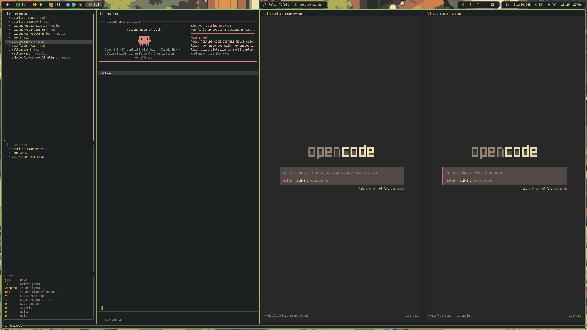

# kmux

> [!WARNING]
> Kmux has a lot of very specific dependencies unique to my own workflow
> (lazygit, worktrunk, sidekick.nvim). As such, it's not intended to be general
> or particularly configurable.

`kmux` is a barebones TUI for monitoring parallel AI coding agents (claude,
opencode, pi). Each agent runs in a tmux pane. kmux runs as the left pane of one
tmux window and shows the agent panes to its right, in three fixed columns. tmux
draws the grid, so kmux works in any terminal.

An agent that is not in the grid runs in a tmux session of its own. kmux moves
its pane into the grid with `join-pane`, so there is no nested tmux and each
layout change is one redraw. A session that starts elsewhere (an editor plugin
that starts an agent, for example) is listed immediately with a dim `P` badge
and gets its place in the grid on the next poll.



## Prerequisites

- **tmux** 3.2 or newer
- **Go** 1.21+ (to build)

## Install

```sh
curl -fsSL https://raw.githubusercontent.com/olli-io/kmux/main/install.sh | sh
```

Or, from a checkout:

```sh
./install.sh
```

It builds from source and installs `kmux` to `~/.local/bin` (override with
`INSTALL_DIR` or `PREFIX`). Make sure the install dir is on your `PATH`.

## Run

Run it in any terminal. Outside tmux, kmux starts a tmux session
(`[kmux][dash]<path>`) and attaches to it. In tmux, the current window becomes
the grid: the pane that runs kmux is the sidebar and agent panes open to its
right:

```sh
kmux
```

Pass a directory to scope kmux to a single git project. The path may be the main
worktree, a linked worktree, or any subdirectory of one:

```sh
kmux ~/git/myproject   # or: cd into the repo and run `kmux .`
```

## The grid

- The grid has three columns. Columns fill from the left. A fourth agent goes
  below the agent in the shortest column.
- Columns that are not in use show one launcher pane. It keeps the agent panes
  at a fixed width. Press Enter in it, select a project, then an agent kind:
  the agent starts and goes into the grid. The launcher is the `kmux-launcher`
  script beside the binary; it uses `fzf` if that is installed. Without the
  script, the pane shows the static text `free column` and accepts no input.
- Each pane has a title line with the agent name. A `[!!]` mark shows that the
  agent waits for an answer. The window name gets the same mark.
- `d` moves an agent out of the grid into a session of its own; the agent
  continues to run. `enter` moves it back in or selects its pane.
- `f` shows the agent at full window size (tmux zoom). While a pane has the
  zoom, kmux does not change the grid.
- A pane that you split in the grid window yourself gets a cell in the grid.
- To move between panes, use your tmux keys.
- When kmux stops, each agent goes into a session of its own and continues to run.
- kmux stops when no terminal shows it: about 10 seconds after you close its
  terminal or detach from its tmux session.

## Launch an agent directly

With `--agent`, kmux skips the dashboard and creates (or attaches to) the tmux
session for one agent in the project containing the given path, attaching it to
the current terminal. The terminal shows only that agent. If the agent is in a
kmux grid, it moves out of the grid; when you detach, the dashboard takes it
back into the grid:

```sh
kmux ~/git/myproject --agent claude     # path then flag
kmux --agent opencode ~/git/myproject   # flag then path, equivalent
kmux --agent pi                         # omit the path to use the current dir
```

The session name follows the same convention the dashboard uses
(`[kmux][CC]<project-path>` for claude, `[kmux][OC]…` for opencode, `[kmux][PI]…`
for pi; worktrees become `[kmux][CC]<project-path>@<worktree>`, e.g.
`[kmux][CC]~/git/myproject@feat`), so an agent launched this way is the very same
agent the dashboard manages. When you open `kmux`, it moves that agent into the
grid.

## Print a session name

`--session` resolves the very same session name without launching anything and
prints it to stdout, for scripting against the running agent. Like `--agent` it
takes a kind and an optional path (default: the current directory), and does
not need tmux:

```sh
kmux --session claude                   # e.g. [kmux][CC]~/git/myproject
kmux --session pi ~/git/myproject       # name for a specific path
```

A session with this name exists only while the agent is not in a grid. To send
text to an agent in all cases, use its pane id. `--pane` prints the pane id of
the running agent and fails if there is none:

```sh
tmux send-keys -t "$(kmux --pane claude)" 'hello' Enter
```

## Run a command outside the sandbox

A sandboxed agent cannot reach docker, ssh or the tmux socket. `kmux-run`
(installed beside `kmux` from a checkout) runs a command in an unsandboxed
terminal, then pastes the exit code and the output tail into the agent's tmux
pane as a prompt message. The full log stays in `/tmp/kmux-run/`.

```sh
kmux-run -C ~/git/myproject -- docker ps        # pastes into $(kmux --pane claude ~/git/myproject)
kmux-run -t '$3' -n 100 -- ./build.sh           # explicit tmux target, 100 lines
```

Ctrl-C stops the command and still pastes the result. `kmux-run -h` lists the flags.

## Config

kmux reads a **default config shipped beside the binary** (installed as
`config.yaml` next to `kmux`), then overlays your optional
`~/.config/kmux/config.yaml` on top. You don't need to copy the default — just
create your own file with the keys you want to change.

```yaml
# Extra project folders for the Projects panel (added to the ~/git discovery).
projects:
  - ~/work/some-repo

# Kill an agent whose pane sits unchanged this long (Go duration; off disables).
idle_timeout: 2h

# Custom command keybindings (the editor and lazygit bindings live here).
customCommands:
  - key: e
    title: Editor
    cmd: $EDITOR {dir}
  - key: g
    title: Lazygit
    cmd: lazygit

# Navigation keybindings — remap any action's key (defaults live in the binary).
# keybindings:
#   killAgent: x
```

See **[docs/configuration.md](docs/configuration.md)** for the full reference:
how config layers combine, all `customCommands` fields and `cmd:` placeholders,
`target:` modes, and the complete list of rebindable navigation keybindings.
